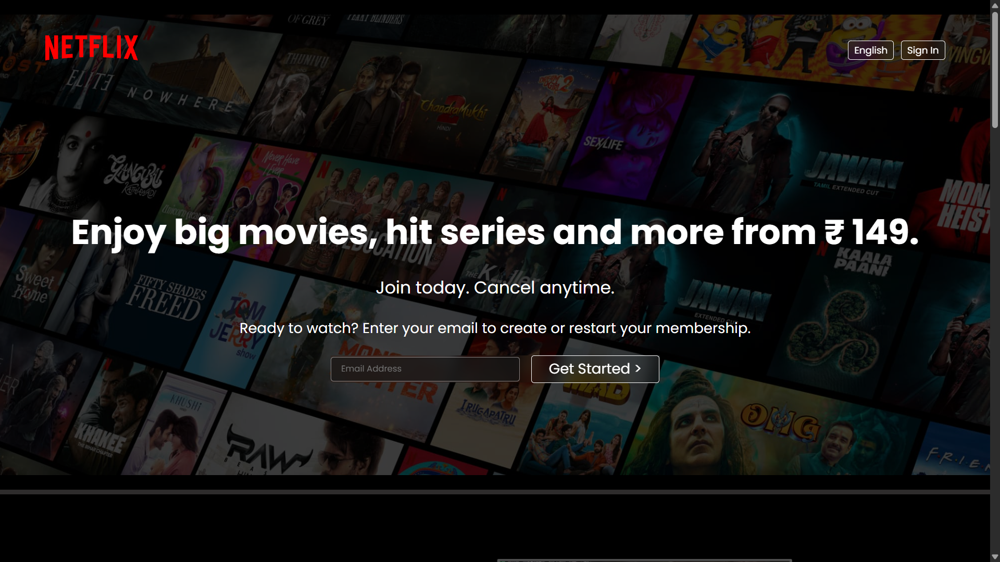
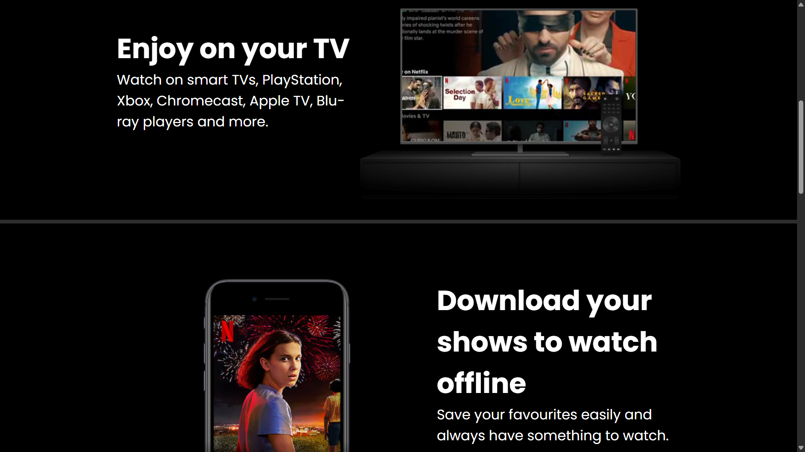
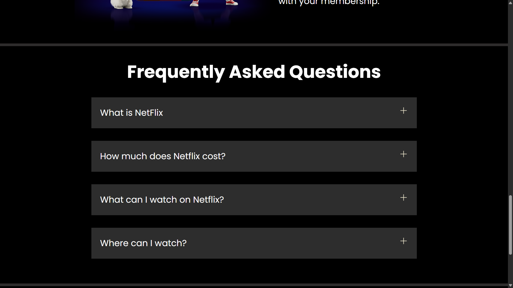

# Netflix UI Clone 🎬

A Netflix-inspired streaming platform homepage UI built using **HTML5 and CSS3**. This project recreates elements of Netflix's visual design as a frontend development practice project.

## 📸 Screenshots

### Homepage






## ✨ Features

- Netflix-inspired homepage design
- Dark-themed user interface
- Custom layouts and styling using CSS
- Movie and show artwork sections (if implemented)
- Responsive layout (if implemented)

## 🛠️ Technologies Used

- **HTML5** — Page structure and content
- **CSS3** — Styling, layouts, colors, and visual effects

## 📂 Project Structure

```text
Netflix/
├── Assets
├── favicon.ico
├── index.html
├── style.css
└── README.md
```

## 🚀 Getting Started

### Prerequisites

A modern web browser and a code editor such as Visual Studio Code.

### Installation

1. Clone this repository:

   ```bash
   git clone https://github.com/himanshu-kumar-2006/Netflix-UI-Clone.git
   ```

2. Open the project folder:

   ```bash
   cd Netflix-UI-Clone
   ```

3. Open `index.html` in your browser.

No additional dependencies are required for a basic HTML and CSS project.

## 🎯 Project Goals

- Practice HTML page structure and CSS styling.
- Improve frontend layout and visual design skills.
- Learn how to organize and document a web development project.
- Practice using Git and GitHub for version control.

## 🔮 Future Improvements

- Improve responsiveness across mobile, tablet, and desktop screens.
- Add interactive elements using JavaScript.
- Add hover effects and transitions where appropriate.
- Refine the layout and accessibility.


## 👨‍💻 Author

**Himanshu Kumar**

- GitHub: [@himanshu-kumar-2006](https://github.com/himanshu-kumar-2006)
- LinkedIn: www.linkedin.com/in/himanshu-kumar2006

Feel free to connect with me and explore my projects!

## ⚠️ Disclaimer

This is an independent educational project created for frontend development practice. It is not affiliated with, endorsed by, or sponsored by Netflix. Netflix and its related trademarks belong to their respective owners.
